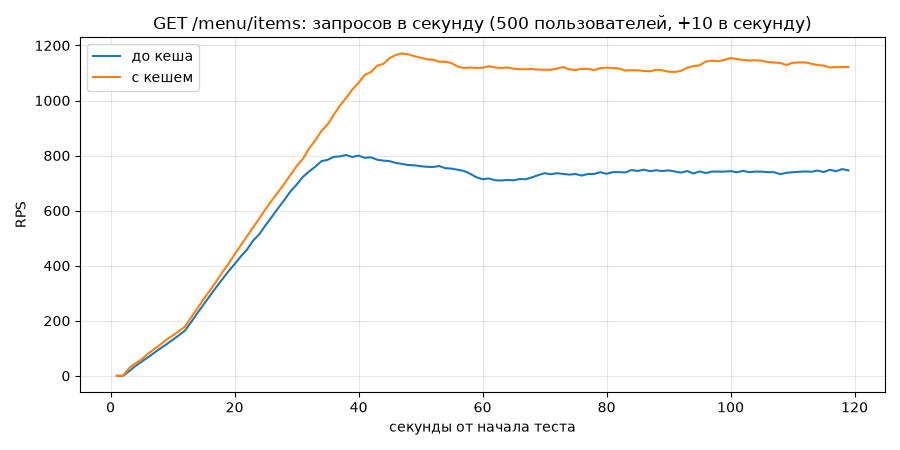
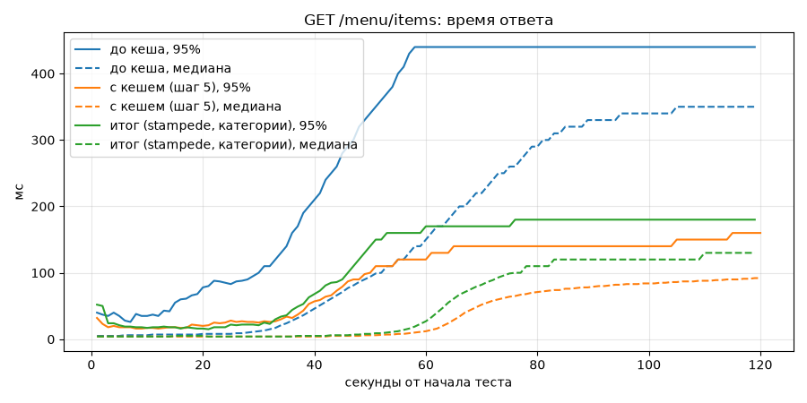

# Лабораторная работа 4. Кеширование меню в Redis (Cache-Aside)

## Задание

В «Сириус.Еде» меню читают сотни раз в минуту, а меняют редко. Без кеша каждый `GET /menu/items` идёт в PostgreSQL. Нужно:

- замерить нагрузку Locust'ом до кеша (500 пользователей, +10 в секунду);
- подключить Redis и сделать Cache-Aside для меню в слое Repository (не в Service);
- TTL 5 минут и событийная инвалидация при создании и изменении блюда;
- повторить замер и показать, что нагрузка с БД ушла;
- на 8 баллов: README с таблицей и графиками «до/после»;
- на 9 баллов: защита от cache stampede;
- на 10 баллов: категории меню в кеше с другим TTL или прогрев кеша при старте. Сделал и то, и другое.

Полный текст задания lab4 - в коммите с тегом `lab4` (`git show lab4:task.md`), задание lab5 лежит в `task-lab5.md`. Задание и README прошлых работ - в коммитах с тегами: `git show lab3:README.md`, `git show lab2:README.md`.

## Что сделано

- `GET /menu/items` - публичный эндпоинт со всем меню. Раньше его в проекте не было.
- `app/core/redis.py` - клиент Redis по методичке.
- Cache-Aside в `PostgresMenuRepository`: ключ `menu:all`, TTL 300 секунд. Сервис и роутер не знают про Redis.
- Инвалидация: `MenuService.create_item` и `update_item` после сохранения вызывают `repository.invalidate_cache()`.
- Защита от cache stampede: при промахе в БД идёт только запрос, взявший блокировку Redis `lock:<ключ>`, остальные ждут и читают кеш.
- Категории: таблица `categories` (миграция), у блюда `category_id`, эндпоинт `GET /menu/categories/{id}` с кешем `menu:category:{id}` на 600 секунд.
- Прогрев кеша при старте приложения (`lifespan` в `main.py`).
- Если Redis недоступен, меню читается прямо из БД (как сказано в шаге 6 методички).
- Замеры Locust: `loadtest/before` (до кеша), `loadtest/final` (с кешем); графики `loadtest/rps.png`, `loadtest/latency.png`; скрипт проверки stampede `loadtest/stampede_check.py`.

## Как запустить

PostgreSQL и Redis:

```bash
docker compose up -d db redis
```

Зависимости (в `requirements.txt` добавлен `locust`, `redis` был ещё с lab3):

```bash
source .venv/bin/activate
pip install -r requirements.txt
```

Миграция с таблицей категорий:

```bash
alembic upgrade head
```

Сервер (как в lab3, Swagger на http://127.0.0.1:8000/docs при `DEBUG=True`):

```bash
uvicorn app.main:app --reload
```

Тесты (нужен Redis, PostgreSQL не нужен):

```bash
python -m unittest discover tests -v
```

### Как делал замеры

Сервер для замеров запускал без `--reload` и с `DEBUG=False`. При `DEBUG=True` SQLAlchemy печатает в терминал каждый SQL-запрос (`echo=settings.DEBUG` из lab3), и замер «до» мерил бы скорость печати в консоль.

```bash
DEBUG=False uvicorn app.main:app --host 127.0.0.1 --port 8000
```

Locust запускал без веб-интерфейса, с теми же параметрами, что в методичке (500 пользователей, spawn rate 10), 2 минуты. Результаты сохраняются в CSV и HTML-отчёт:

```bash
locust -f locustfile.py --headless -u 500 -r 10 -t 120s --host http://127.0.0.1:8000 --csv loadtest/before/locust --html loadtest/before/report.html
```

То же самое можно сделать через веб-интерфейс: `locust -f locustfile.py --host=http://127.0.0.1:8000`, открыть http://localhost:8089.

Нагрузку на БД считал по статистике PostgreSQL: сколько раз читали таблицу `menu_items` и сколько было транзакций в базе (до и после теста):

```bash
docker compose exec db psql -U sirius -d sirius_food -c "SELECT seq_scan + idx_scan FROM pg_stat_user_tables WHERE relname = 'menu_items'"
docker compose exec db psql -U sirius -d sirius_food -c "SELECT xact_commit + xact_rollback FROM pg_stat_database WHERE datname = 'sirius_food'"
```

Load average - `cat /proc/loadavg` сразу после теста.

Графики:

```bash
pip install matplotlib
python loadtest/plot.py
```

Проверка stampede (сервер должен работать):

```bash
python -m loadtest.stampede_check
```

Данные для замера. В меню было 3 блюда, это нереально мало для столовой. Перед замером «до» добавил через `POST /menu/items` (под поваром) ещё 47 блюд, всего 50. Позже, когда появились категории, разложил их по 6 категориям через `PATCH /menu/items/{id}`.

## История коммитов

```text
d615df4 Lab3: задание (task.md) и README   (тег lab3)
cb74a8d Lab4 шаг 1: публичный GET /menu/items (без кеша) и locustfile.py для замера baseline
83a67fe Lab4 шаги 2-3: клиент Redis (app/core/redis.py), Cache-Aside для меню в PostgresMenuRepository
        (сюда же попали результаты замера «до» - loadtest/before)
51c0777 Lab4 шаг 4: событийная инвалидация кеша меню при создании и изменении блюда
4a39a66 Lab4: защита от cache stampede через блокировку Redis, скрипт проверки loadtest/stampede_check.py; результаты Locust до/после
d397af7 Lab4: категории меню (таблица categories, миграция), GET /menu/categories/{id} с кешем menu:category:{id} на 10 минут
fe385a0 Lab4: прогрев кеша меню при старте (lifespan); если Redis недоступен, меню читается из БД
1233f5f Lab4: итоговый замер Locust и графики до/после (loadtest/plot.py)
...     Lab4: задание (task.md) и README
```

Замер «до» сделан на коммите `cb74a8d`, замер «с кешем» - на итоговом коде `fe385a0`. Был ещё промежуточный замер после шагов 1-4 (коммит `51c0777`), он лежит в `loadtest/after`, в таблицу не вошёл.

## Структура (что добавилось после lab3)

```text
app/
├── core/
│   └── redis.py                 # новый: клиент Redis, check_redis_connection
├── models.py                    # Category, MenuItem.category_id
├── memory_db.py                 # CategoryRecord, категории заполняются в clear()
├── schemas.py                   # category_id в MenuItemCreate и MenuItemUpdate
├── main.py                      # lifespan: прогрев кеша при старте
└── modules/menu/
    ├── repository.py            # Cache-Aside, блокировка, invalidate_cache, warm_up_cache
    ├── service.py               # get_menu, get_category, вызов invalidate_cache
    └── router.py                # GET /menu/items, GET /menu/categories/{id}
alembic/versions/7bb4ce2dba0d_add_categories.py
locustfile.py
loadtest/
├── before/  final/  (after/)   # результаты Locust (CSV, HTML-отчёт, вывод), load average, статистика PostgreSQL
├── rps.png  latency.png         # графики
├── plot.py                      # рисует графики из CSV
└── stampede_check.py            # проверка защиты от cache stampede
```

`service.py` по-прежнему не импортирует ни redis, ни sqlalchemy:

```bash
$ grep -n "import" app/modules/menu/service.py
5:from app.exceptions import NotFoundError
6:from app.modules.menu.repository import MenuRepository
```

## Как работает кеш

Ключи в Redis:

```text
menu:all              всё меню, JSON-список блюд, TTL 300 с
menu:category:{id}    категория с её блюдами, TTL 600 с
lock:menu:all         блокировка на время чтения из БД (живёт максимум 10 с)
lock:menu:category:{id}
```

Чтение (`GET /menu/items`):

```text
router -> MenuService.get_menu() -> repository.get_all_items()
                                          |
                          redis GET menu:all
                          /                 \
                есть (hit)                  нет (miss)
           json.loads -> ответ        взять lock:menu:all (не ждать)
                                     /                         \
                                 взяли                         не взяли
                     ещё раз GET menu:all            подождать 0.05 с и снова
                     SELECT из PostgreSQL            GET menu:all (там уже
                     SETEX menu:all 300 <json>       будут данные от того,
                     отпустить блокировку            кто взял блокировку)
```

Изменение (`POST /menu/items`, `PATCH /menu/items/{id}`): сервис сохраняет блюдо в БД, потом `repository.invalidate_cache()` удаляет `menu:all` и все `menu:category:*`. Следующий GET получит miss и положит в кеш свежие данные.

Две инвалидации вместе:
- событийная - когда меню меняют через наше API, кеш сбрасывается сразу;
- по TTL - если меню поменяли в обход API (руками в БД, другим сервисом) или Redis потерял команду удаления, старые данные проживут не больше 5 минут.

## Что сделал не так, как в методичке, и почему

1. В проекте не было `GET /menu/items` (с lab2 были только `POST /menu/items` и `PATCH /menu/items/{id}`). Добавил его, публичным: меню не секрет, и методичка в locustfile сама предлагает сделать эндпоинт публичным для замера.
2. Репозиторий отдаёт меню списком словарей, а не объектами `MenuItem`. В методичке на miss возвращаются ORM-объекты, а на hit - `MenuItem(**item)` из словарей, то есть два разных вида объектов, и в JSON методички нет `is_available`. У меня и из БД, и из кеша приходит одно и то же: список словарей, собранный одной функцией `item_to_dict`. Роутеру больше ничего и не нужно - он отдаёт JSON.
3. Имена методов как в lab2: `get_item_by_id`, `save_item`, `update_item`, а не `get_by_id`, `save`. Новый метод назвал `get_all_items` в том же стиле. Ошибки - `ValueError` и `NotFoundError` из lab2, а не `MenuItemNameExistsError`.
4. С lab2 у меню есть абстрактный `MenuRepository` и две реализации: `PostgresMenuRepository` и `InMemoryMenuRepository` (для тестов и CI). Кеш есть только в PostgreSQL-реализации. У in-memory `invalidate_cache` и `warm_up_cache` ничего не делают: данные и так в памяти.
5. Меню сортируется по `id` (`order_by`). Без `ORDER BY` PostgreSQL не обещает порядок строк, и меню после каждого обновления кеша могло бы перемешиваться.
6. `json.dumps(..., ensure_ascii=False)` - чтобы в `redis-cli get menu:all` были видны русские названия, а не `Бо...`.
7. Проверка `if cached_data is not None`, а не `if cached_data:`. Разница появится, если закешировать пустую строку. С JSON (`"[]"`) работает одинаково, но так точнее читается «ключ есть / ключа нет».
8. Защита от stampede сделана не через `with redis_client.lock(...)` (там все ждущие запросы по очереди берут блокировку), а так: блокировку пытаемся взять без ожидания (`blocking=False`); кто не взял - спит 50 мс и снова смотрит в кеш. Так ждущие получают данные из кеша сразу, как только он заполнен, и не выстраиваются в очередь за блокировкой. После взятия блокировки кеш проверяется ещё раз: пока мы её брали, его мог заполнить другой запрос.
9. Категорий в проекте не было совсем (в методичке упоминается «JOIN категорий», но в модели lab2 их нет). Сделал таблицу `categories` и миграцию, которая заполняет 6 категорий (как роли в lab3), у блюда - необязательный `category_id` (у старых блюд категории нет). Категорию можно передать при создании и изменении блюда; несуществующая категория - 404.
10. `None` (категории нет) не кладётся в кеш. Иначе после появления категории с таким id эндпоинт ещё 10 минут отвечал бы 404.
11. `invalidate_cache` удаляет не только `menu:all`, но и все `menu:category:*`: блюдо могло перейти из одной категории в другую, и устареют обе. Ключи ищу через `SCAN` (`scan_iter`), а не `KEYS`: `KEYS` обходит всю базу Redis за одну команду и блокирует его на это время.
12. Прогрев сделан через `lifespan`, а не через `@app.on_event("startup")`: в нашей версии FastAPI (0.110) `on_event` помечен устаревшим (`DeprecationWarning`), `lifespan` - его официальная замена. Работает так же: код до `yield` выполняется при старте. При прогреве кеш сначала сбрасывается: в Redis мог остаться `menu:all` от прошлого запуска, а меню за это время могли поменять в БД.
13. Если Redis недоступен, `_cache_aside` ловит `redis.ConnectionError` и читает меню прямо из БД, а `invalidate_cache` просто пропускает удаление. В методичке (шаг 6) сказано, что без Redis приложение должно продолжать работать, но в коде методички на это ничего нет: проверял, без Redis `GET /menu/items` отдавал 500. Прогрев при недоступном Redis пропускается (`check_redis_connection` из методички), и приложение всё равно стартует.
14. Ожидаемый результат методички после кеша «2–5 мс, RPS в десятки раз» у меня не получился - объяснение в разделе с замерами.

## Разбор кода

### app/core/redis.py

Как в методичке. `redis.from_url(settings.REDIS_URL, decode_responses=True)` - клиент, который возвращает строки (а не `bytes`), их сразу можно отдать в `json.loads`. Подключение ленивое: соединение открывается при первой команде. `check_redis_connection()` делает `PING` и возвращает `False` вместо исключения, если Redis не отвечает. В `app/core/rate_limit.py` из lab3 остался свой клиент - его не трогал.

### app/modules/menu/repository.py

Константы: `MENU_ALL_KEY = "menu:all"`, `MENU_ALL_TTL = 300`, `MENU_CATEGORY_TTL = 600`.

- `item_to_dict(item)` - блюдо (ORM-объект или запись `memory_db`) в словарь: `id`, `name`, `price`, `is_available`, `category_id`. Такой словарь и кладётся в кеш, и отдаётся клиенту.
- `MenuRepository` - абстрактный интерфейс. Новые методы: `get_all_items`, `get_category`, `invalidate_cache`, `warm_up_cache`.
- `PostgresMenuRepository._cache_aside(key, ttl, load_from_db)` - вся логика кеша в одном месте, её используют и меню, и категории. `load_from_db` - функция, которая читает данные из БД; её передают, потому что запрос для меню и для категории разный. Внутри:
  1. `GET key` - есть данные: `json.loads` и вернуть (hit);
  2. нет данных (miss): `redis_client.lock(f"lock:{key}", timeout=10).acquire(blocking=False)`. Блокировка в Redis - это ключ `lock:menu:all`, который ставится командой `SET ... NX PX 10000` (только если ключа нет). Поэтому взять её может только один запрос, даже если приложение запущено в нескольких процессах. `timeout=10` - если процесс упадёт с блокировкой, через 10 секунд ключ удалится сам;
  3. взяли блокировку: ещё раз `GET key`, если пусто - `load_from_db()`, `SETEX key ttl json`, вернуть данные; блокировка отпускается в `finally`;
  4. не взяли: `time.sleep(0.05)` и на начало цикла;
  5. `except redis.ConnectionError` вокруг всего - Redis лежит, просто читаем из БД.
- `get_all_items()` - `load_from_db` делает `SELECT * FROM menu_items ORDER BY id`, кешируется в `menu:all` на 300 с.
- `get_category(category_id)` - категория и её блюда, ключ `menu:category:{id}`, 600 с. Нет категории - `None`, в кеш не кладётся.
- `invalidate_cache()` - `DEL menu:all` и `DEL` каждого ключа `menu:category:*`.
- `warm_up_cache()` - `invalidate_cache()` и `get_all_items()`: сбросить старое и положить в кеш свежее меню.
- `InMemoryMenuRepository` - те же методы над `memory_db`, без кеша.

Почему кеш именно здесь, а не в сервисе: см. контрольный вопрос 1.

### app/modules/menu/service.py

- `get_menu()` - просто `repository.get_all_items()`. Бизнес-правил у чтения меню нет.
- `get_category(id)` - `NotFoundError`, если репозиторий вернул `None`.
- `create_item` и `update_item` - как в lab2, плюс проверка категории (если передана) и `self.repository.invalidate_cache()` после сохранения. Сервис не знает, что такое Redis: для него это «сообщить хранилищу, что меню изменилось». У in-memory репозитория этот вызов ничего не делает.

### app/modules/menu/router.py

- `GET /menu/items` - без `require_role`, собирает `MenuService(get_menu_repository(db))` и возвращает `get_menu()`.
- `GET /menu/categories/{category_id}` - то же, `NotFoundError` -> 404.
- `POST` и `PATCH` - как в lab3 (только `admin` и `cook`), передают `category_id`; у `POST` добавлен перехват `NotFoundError` -> 404 для неверной категории.

`get_db` создаёт сессию SQLAlchemy на каждый запрос, но соединение с PostgreSQL берётся из пула только при первом SQL. Поэтому при попадании в кеш база не трогается вообще.

### app/main.py

`warm_up_menu_cache()`: если Redis не отвечает - печатает сообщение и выходит. Иначе открывает сессию `SessionLocal()`, берёт репозиторий через `get_menu_repository` (в memory-режиме это in-memory, прогревать нечего) и вызывает `warm_up_cache()`. `lifespan` вызывает её до `yield`, то есть до того, как сервер начнёт принимать запросы.

### Модель и миграция

`Category(id, name)`, `MenuItem.category_id` - внешний ключ на `categories.id`, `nullable=True`. Миграция `7bb4ce2dba0d_add_categories` создаёт таблицу, вставляет «Супы, Горячее, Гарниры, Салаты, Напитки, Выпечка» и добавляет колонку с внешним ключом. `downgrade` убирает всё обратно (проверял `alembic downgrade -1` и снова `upgrade head`). `alembic check` после миграции: «No new upgrade operations detected». В `memory_db` те же 6 категорий заполняются в `clear()`.

### locustfile.py

Как в методичке: виртуальный пользователь ждёт 0.1–0.5 с и делает `GET /menu/items`. Токен не нужен - эндпоинт публичный.

### loadtest/stampede_check.py

Наш запрос к меню выполняется за 3-4 мс. За это время одновременные промахи почти не пересекаются, и без подготовки stampede не увидеть (проверял: 200 запросов разом - 1 чтение из БД даже без защиты). Поэтому скрипт имитирует «тяжёлую БД под нагрузкой»:

1. заранее открывает 200 HTTP-соединений;
2. запоминает, сколько раз читали `menu_items` (`pg_stat_user_tables`);
3. в отдельной транзакции делает `LOCK TABLE menu_items IN ACCESS EXCLUSIVE MODE` - теперь любой `SELECT` из этой таблицы ждёт;
4. удаляет `menu:all` (как будто истёк TTL) и через `threading.Barrier` отправляет 200 запросов одновременно;
5. через 2 секунды снимает блокировку таблицы (`rollback`), ждёт ответов;
6. снова смотрит счётчик. Статистику PostgreSQL обновляет с задержкой (до 10 секунд), поэтому перед каждым чтением счётчика `sleep(11)`.

### loadtest/plot.py

Читает `locust_stats_history.csv` замеров «до кеша» и «с кешем» (строки `Aggregated`, по одной в секунду) и рисует RPS и время ответа (медиана и 95%) от времени.

## Что происходит при запуске

1. `uvicorn` импортирует `app.main`: читаются настройки, создаются `engine` и клиенты Redis (подключений ещё нет).
2. Перед приёмом запросов выполняется `lifespan` -> `warm_up_menu_cache()`: `PING` в Redis, удаление `menu:all` и `menu:category:*`, один `SELECT` из `menu_items`, `SETEX menu:all 300`.
3. Первый `GET /menu/items`: `GET menu:all` в Redis - hit, ответ без похода в БД.
4. Повар делает `PATCH /menu/items/45`: блюдо сохраняется в БД, `menu:all` и категории удаляются из Redis.
5. Следующий `GET /menu/items`: miss -> блокировка -> `SELECT` -> `SETEX` -> ответ уже с новой ценой. Остальные запросы снова читают из кеша.
6. Через 5 минут без изменений `menu:all` удаляется сам (TTL), следующий запрос снова сходит в БД.

## Результаты замеров

Условия: всё на одном ноутбуке (12 ядер): uvicorn с одним процессом, PostgreSQL и Redis в Docker, Locust. 500 пользователей, +10 в секунду, 2 минуты, в меню 50 блюд. Цифры - итоговая сводка Locust за весь тест (вместе с разгоном первые 50 секунд), полностью - в `loadtest/*/locust_output.txt`.

| | До кеша | С кешем |
|---|---|---|
| Запросов за 2 минуты | 80 666 | 115 518 |
| RPS (среднее за тест) | 676 | 968 |
| RPS когда все 500 запущены (по графику) | ~740 | ~1120 |
| Среднее время ответа | 286 мс | 109 мс |
| Медиана | 350 мс | 130 мс |
| 95-й перцентиль | 440 мс | 180 мс |
| 99-й перцентиль | 490 мс | 200 мс |
| Ошибки | 0 | 0 |
| Чтений `menu_items` в PostgreSQL за тест | 80 834 | 1 |
| Транзакций в БД за тест | 85 738 | 9 |
| Load average (1 мин) после теста | 4.22 | 2.90 |

«До кеша» - коммит `cb74a8d` (только `GET /menu/items`), «С кешем» - итоговый код со всеми доп. заданиями (коммит `fe385a0`).

Один запрос без нагрузки (среднее по 20 промахам и 200 попаданиям): из БД 3.6 мс, из Redis 1.0 мс.





Что видно:

- Главное: до кеша на каждый запрос был поход в PostgreSQL (80 834 чтения таблицы на 80 666 запросов), с кешем - 1 за 2 минуты. Это и есть «кеш снял нагрузку с СУБД».
- RPS вырос примерно в 1.5 раза, время ответа упало примерно в 2.5 раза.
- До кеша с ростом числа пользователей время ответа растёт до 350-440 мс: запросы ждут свободное соединение из пула SQLAlchemy (5 + 10 соединений на 40 потоков FastAPI) и сам PostgreSQL.

Почему не «2–5 мс и RPS в десятки раз», как в методичке. Теперь упираемся не в БД, а в сам процесс uvicorn. Он один и выполняет Python-код (FastAPI, JSON) на одном ядре. Во время теста с кешем `top` показывал:

```text
    PID USER      PR  NI    VIRT    RES    SHR S  %CPU  %MEM     TIME+ COMMAND
  60098 hunter    20   0 1572772 108460  34296 S 104,9   0,7   2:04.52 uvicorn
  63314 hunter    25   5  793776  78056  22556 S  47,7   0,5   0:08.26 locust
  59102 999       20   0  138284  15872   7988 S   9,5   0,1   0:03.52 redis-s+
```

PostgreSQL в списке нет совсем. 500 пользователей с паузой 0.1–0.5 с хотят примерно 1600 запросов в секунду, а один процесс отдаёт около 1100-1200. Остальные ждут в очереди - отсюда ~110 мс. Без очереди (один запрос) ответ из кеша - 1 мс. Дальше RPS поднимается запуском нескольких процессов (`uvicorn --workers 4`) или нескольких реплик за балансировщиком. Кеш в Redis для этого подходит: он общий для всех процессов, а блокировка stampede тоже работает между процессами. К тому же у нас запрос к БД лёгкий (50 строк, без JOIN, база на той же машине); на «тяжёлом» запросе разница была бы больше.

Load average здесь мало что показывает: Locust работает на той же машине и сам грузит процессор, а ядер 12. Но по нему тоже видно, что без кеша нагрузка выше (4.22 против 2.90).

## Пример вывода

### Тесты

```text
$ python -m unittest discover tests
.............................................
----------------------------------------------------------------------
Ran 45 tests in 6.267s

OK
```

### Шаг 2: проверка Redis

```text
$ python -c "from app.core.redis import redis_client; print(redis_client.ping())"
True
```

### Шаг 4: проверка кеша и инвалидации (запросы скриптом, токен повара)

```text
redis exists menu:all -> 0
GET /menu/items -> блюд: 50 200
redis exists menu:all -> 1 | ttl -> 300
redis get menu:all -> [{"id": 1, "name": "Борщ", "price": 100.0, "is_available": true}, {"id": 2, "name": "яблоко", "price": 10.0, "is_availab ...
POST /menu/items {"name": "Суп дня", "price": 150} -> 200 {"status":"success","item_id":51}
redis exists menu:all -> 0
GET /menu/items -> блюд: 51 последнее: {'id': 51, 'name': 'Суп дня', 'price': 150.0, 'is_available': True}
PATCH /menu/items/51 {"price": 170} -> 200 {"status":"success","item_id":51}
redis exists menu:all -> 0
GET /menu/items -> последнее: {'id': 51, 'name': 'Суп дня', 'price': 170.0, 'is_available': True}
```

Новое блюдо и новая цена видны сразу, хотя TTL ещё не истёк. (Блюдо 51 потом удалил из БД, чтобы замеры до и после шли на одинаковом меню.)

### Cache stampede

Без защиты (коммит `51c0777`, только шаги 1-4):

```text
$ python -m loadtest.stampede_check
Запросов: 200, ответов 200: 200
Чтений menu_items в PostgreSQL: 40
```

40 - это сколько запросов FastAPI выполняет одновременно (у синхронных эндпоинтов пул из 40 потоков). Все 40 увидели пустой кеш и пошли в БД за одними и теми же данными. Остальные 160 пришли, когда кеш уже заполнили.

С блокировкой:

```text
$ python -m loadtest.stampede_check
Запросов: 200, ответов 200: 200
Чтений menu_items в PostgreSQL: 1
```

### Категории

```text
redis keys menu:* ->
GET /menu/categories/5 -> 200 {"id":5,"name":"Напитки","items":[{"id":39,"name":"Чай","price":205.0,"is_available":true,"category_id":5},{"id":40,"name":"Кофе",...
GET /menu/categories/1 -> 200 {"id":1,"name":"Супы","items":[{"id":1,"name":"Борщ","price":100.0,"is_available":true,"category_id":1},...
GET /menu/items -> 200 [{"id":1,"name":"Борщ","price":100.0,"is_available":true,"category_id":1},...
redis keys menu:* -> menu:category:1 menu:all menu:category:5
ttl menu:all -> 300 | ttl menu:category:5 -> 600
GET /menu/categories/99 -> 404 {"detail":"Категория не найдена"}
redis keys menu:category:99 ->
POST /menu/items {"name": "Лимонад", "price": 60, "category_id": 99} -> 404 {"detail":"Категория не найдена"}
PATCH /menu/items/45 {"price": 75} -> 200 {"status":"success","item_id":45}
redis keys menu:* ->
GET /menu/categories/5 -> 200 {"id":5,"name":"Напитки","items":[...
```

Разные TTL видны: 300 у меню и 600 у категории. После изменения блюда сброшены все ключи меню.

### Прогрев кеша

Перед запуском положил в Redis «старые» данные: `SET menu:all '[{"id":1,"name":"stale"}]'` и `SET menu:category:1 old`. Запуск сервера и Redis сразу после него:

```text
INFO:     Started server process [57072]
INFO:     Waiting for application startup.
INFO:     Application startup complete.
INFO:     Uvicorn running on http://127.0.0.1:8000 (Press CTRL+C to quit)

$ redis-cli keys 'menu:*'
menu:all
$ redis-cli get menu:all
[{"id": 1, "name": "Борщ", "price": 100.0, "is_available": true, "category_id": 1}, {"id": 2, "name": "яблоко", ...
```

Старые ключи удалены, `menu:all` заполнен свежими данными до первого запроса.

### Redis выключен (`docker compose stop redis`)

Токен повара взял заранее (логин без Redis не работает: на нём rate limiting из lab3).

```text
INFO:     Waiting for application startup.
INFO:     Application startup complete.
Redis недоступен, прогрев кеша меню пропущен
INFO:     127.0.0.1:40116 - "GET /menu/items HTTP/1.1" 200 OK
INFO:     127.0.0.1:40136 - "PATCH /menu/items/45 HTTP/1.1" 200 OK
INFO:     127.0.0.1:40146 - "GET /menu/categories/5 HTTP/1.1" 200 OK
```

Приложение работает, меню читается из БД. До этой доработки было `GET /menu/items HTTP/1.1" 500` с `redis.exceptions.ConnectionError`.

Заодно увидел недостаток Cache-Aside. Redis при `stop` сохранил снимок на диск (так он настроен по умолчанию) и после `start` поднял старый `menu:all`. Цену блюда 45 поменяли на 80, пока Redis лежал, а кеш вернулся с 75:

```text
$ redis-cli keys '*'
menu:all
rate_limit:127.0.0.1:/auth/login
$ curl -s http://127.0.0.1:8000/menu/items     (блюдо 45)
"id":45,"name":"Сок яблочный","price":75.0,...
```

Удалить ключ было некому: инвалидация шла, когда Redis не работал. Такие старые данные живут не дольше TTL (5 минут) - для этого TTL и нужен вместе с событийной инвалидацией.

## Ответы на контрольные вопросы

**1. Почему кеширование в Repository, а не в Service? Как это связано с Clean Architecture?**
Кеш - это способ хранения и чтения данных, то есть инфраструктура, как и SQLAlchemy. Repository - единственный слой, который знает, где лежат данные. Сервис содержит бизнес-правила («нет блюда - ошибка», «название уникально») и не должен знать, откуда пришло меню: из PostgreSQL, Redis или памяти. Если положить Redis в сервис, бизнес-логика начнёт зависеть от конкретной технологии (правило зависимостей нарушено), а unit-тесты сервиса с in-memory репозиторием потребуют Redis. У нас `service.py` не импортирует redis, а тесты сервиса работают без Redis и БД. Заменить Redis на что-то другое - правка одного файла `repository.py`.

**2. Что такое Cache-Aside и какие у него недостатки?**
Приложение само управляет кешем: сначала читает из кеша, при промахе читает из БД и кладёт результат в кеш. При изменении данных пишет в БД и удаляет ключ из кеша. Недостатки:
- первый запрос после промаха медленный (идёт в БД);
- данные могут быть устаревшими: изменение в обход приложения или потерянное удаление ключа (пример с перезапуском Redis выше) - старое живёт до конца TTL;
- гонка: запрос прочитал из БД старые данные, в это время другой запрос обновил БД и удалил ключ, а первый записал в кеш уже устаревшее. Тоже лечится TTL;
- cache stampede при истечении ключа под нагрузкой;
- логика кеша в коде приложения: про инвалидацию нужно не забыть в каждом месте, где данные меняются.

**3. Что будет, если Redis перезагрузится во время пиковой нагрузки? Как это называется?**
Кеш станет пустым (если Redis не сохранил снимок на диск), и все запросы разом получат промах и пойдут в БД - «холодный кеш», а массовый одновременный промах - cache stampede (thundering herd, «эффект стада»). Пока Redis лежит, у нас запросы идут прямо в БД (код ловит `ConnectionError`), то есть работает медленно, как до кеша. Когда Redis поднялся, блокировка `lock:menu:all` пропускает в БД только один запрос на ключ, остальные ждут кеш. Наш проверочный скрипт показывает именно это: 40 чтений из БД без защиты и 1 с защитой.

**4. Почему TTL меню 5 минут, а не 1 час?**
TTL - это максимальное время, сколько пользователь может видеть устаревшее меню, если событийная инвалидация не сработала (меню поменяли прямо в БД, удаление ключа не дошло до Redis). Блюдо закончилось, а его час ещё можно заказать - плохо. С другой стороны, раз в 5 минут один запрос в БД - это ничто по сравнению с сотнями в секунду, выигрыш почти весь сохраняется. Категории меняются ещё реже, им дал 10 минут.

**5. Как событийная инвалидация дополняет инвалидацию по TTL?**
Событийная даёт свежие данные сразу после изменения через наше API (`invalidate_cache` в сервисе). TTL - страховка на случаи, которые событийная не ловит: изменение в обход API, падение Redis во время удаления, гонка из вопроса 2, ошибка в коде (забыли вызвать `invalidate_cache`). Только TTL - меню устаревает до 5 минут после каждого изменения. Только события - любая потерянная инвалидация оставляет старые данные навсегда.

**6. Какие данные в «Сириус.Еде» категорически нельзя кешировать и почему?**
- Баланс пользователя: по нему списываются деньги, устаревшее значение - заказ без денег или двойное списание.
- Статус и состав заказа, доставки: повар и курьер должны видеть актуальное состояние, иначе заказ приготовят дважды или потеряют.
- Права и блокировка пользователя (роль, `is_blocked`): после блокировки или смены роли старые права в кеше дали бы доступ.
- Refresh-токены и их отзыв: rotation из lab3 проверяет `is_revoked` в БД, с кешем отозванный токен работал бы до конца TTL.
- Персональные данные (email, телефон, хеш пароля): лишняя копия в ещё одном хранилище.
Общее правило: нельзя кешировать то, что часто меняется, где ошибка стоит денег или безопасности, и что читают один-два раза (кешировать нет смысла).

**7. Как решить cache stampede, если ключей 10 000?**
- Блокировка на каждый ключ, как у нас: `lock:<ключ>` создаётся только при промахе этого ключа, поэтому 10 000 ключей не мешают друг другу. Это уже работает и для `menu:category:{id}`.
- Случайный разброс TTL (jitter): `300 + random(0, 60)`. Если ключи заполнялись одновременно (например, прогревом), без разброса они и истекут одновременно, и в БД пойдут тысячи промахов в одну секунду.
- Вероятностное раннее обновление: незадолго до истечения TTL запрос с небольшой вероятностью сам обновляет ключ, пока остальные читают ещё живой кеш.
- Прогрев и фоновое обновление самых популярных ключей задачей по расписанию, до истечения TTL.

## Вопросы из рефлексии (шаг 6)

**Что будет, если TTL истечёт во время пиковой нагрузки?**
Cache stampede: все запросы, пришедшие до того, как первый заполнит кеш, идут в БД. У нас - до 40 одновременных одинаковых запросов (размер пула потоков). С блокировкой - 1.

**Что если меню будет меняться каждую минуту?**
Кеш будет сбрасываться каждую минуту, и раз в минуту один запрос пойдёт в БД (с блокировкой - ровно один). При сотнях запросов в секунду это всё равно почти 100% попаданий, кеш полезен. Плохо стало бы, если бы данные менялись чаще, чем читаются: тогда кеш только мешает (лишние операции в Redis и сброс на каждое изменение).

**Что будет, если Redis упадёт?**
В нашей версии - приложение продолжит работать, меню читается из БД, то есть так же медленно, как в замере «до». Логин при этом не работает: на Redis rate limiting из lab3. Проверка выше.

## Другие вопросы, которые могут задать

**Что такое hit и miss?**
Hit - данные нашлись в кеше, в БД не ходим. Miss - в кеше нет (ещё не клали, истёк TTL или удалили инвалидацией), идём в БД и кладём в кеш.

**Почему `SETEX`, а не `SET`?**
`SETEX key ttl value` ставит значение и время жизни одной командой. Если сделать `SET`, а потом `EXPIRE`, и между ними процесс упадёт, ключ останется навсегда без TTL.

**Почему у блокировки `timeout=10`?**
Если процесс взял блокировку и упал (или завис), без таймаута ключ `lock:menu:all` остался бы навсегда, и в БД не пошёл бы больше никто - все ждали бы вечно. С таймаутом через 10 секунд блокировка снимется сама.

**Почему блокировка в Redis, а не `threading.Lock` / `asyncio.Lock`?**
Локальная блокировка работает только внутри одного процесса. При `uvicorn --workers 4` или нескольких репликах у каждого процесса своя, и в БД пойдёт по запросу от каждого. Блокировка в Redis одна на всех. К тому же эндпоинты у нас синхронные (выполняются в потоках), `asyncio.Lock` для них не подходит.

**Почему эндпоинты меню без токена?**
Меню - публичная информация, её видит любой студент, и методичка для замера сама предлагает сделать эндпоинт публичным. Менять меню по-прежнему могут только `admin` и `cook`.

**Что лежит в кеше? Не попадёт ли туда лишнее?**
Только то, что и так отдаётся всем: id, название, цена, доступность, категория блюда. Ничего про пользователей. Посмотреть: `docker compose exec redis redis-cli get menu:all`.

**Почему RPS вырос в 1.5 раза, а время ответа упало в 2.5 раза?**
Пользователи Locust ждут ответ, а потом ещё 0.1–0.5 с. Чем быстрее ответ, тем чаще каждый пользователь шлёт следующий запрос, но 500 пользователей всё равно не могут дать больше ~1600 запросов в секунду. А сервер упирается в одно ядро CPU (см. `top` выше), поэтому RPS ограничен им, а не базой.

**Как убедиться, что запрос пришёл из кеша?**
Включить `DEBUG=True`: SQLAlchemy печатает каждый SQL. При hit в логе нет `SELECT ... FROM menu_items`, при miss - есть. Или смотреть счётчик `pg_stat_user_tables`, как в замерах.
