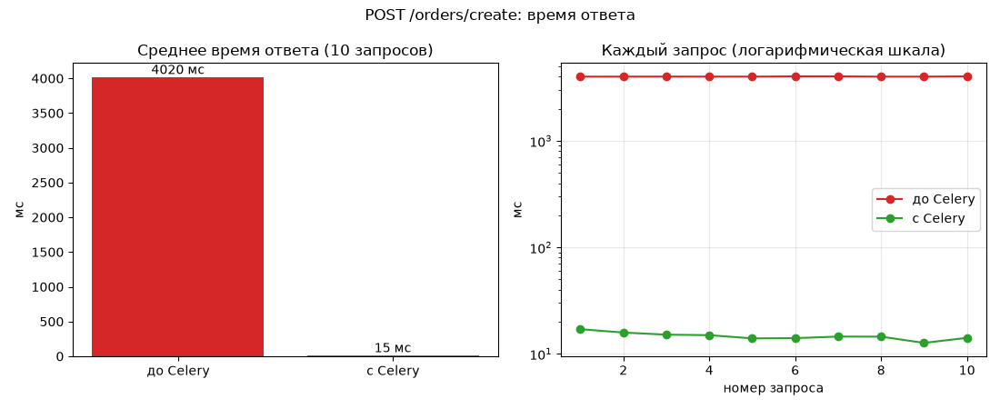
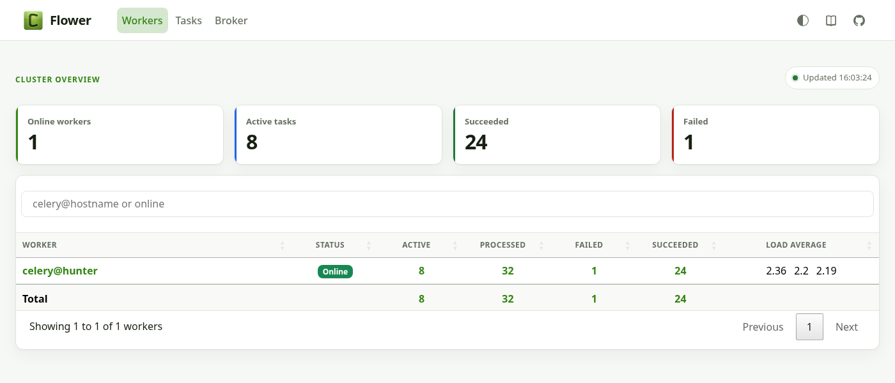
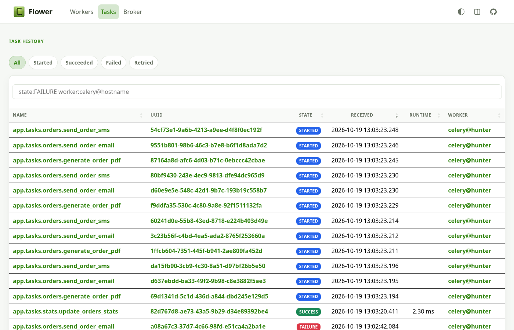
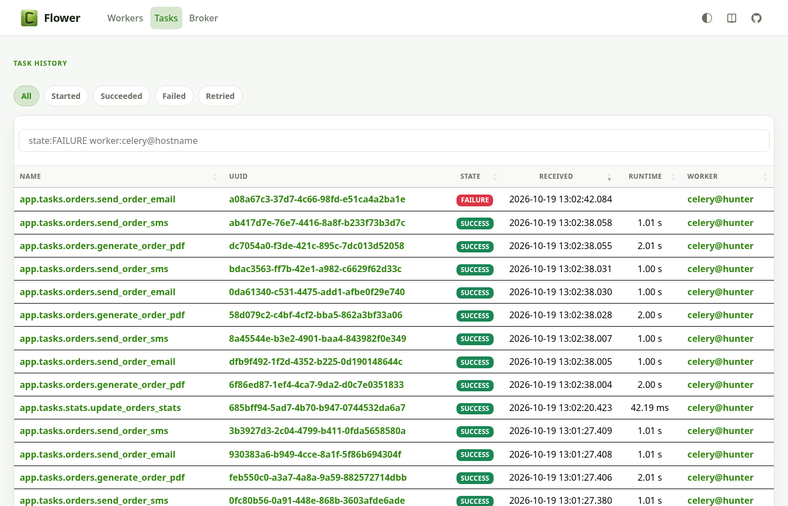
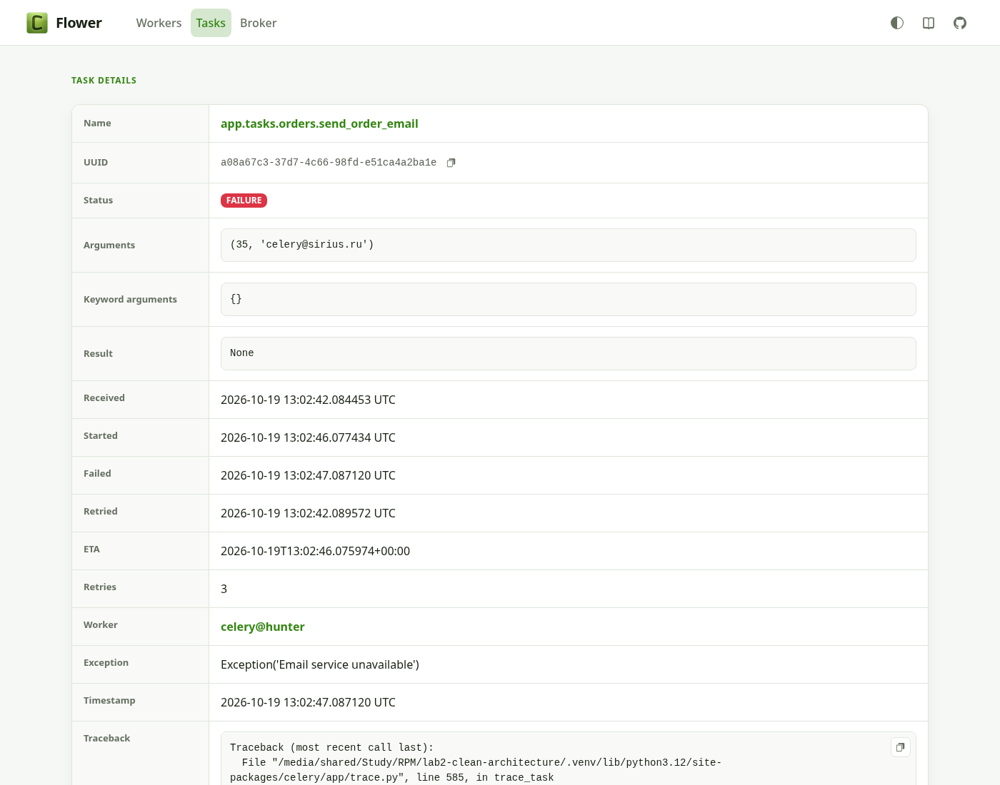
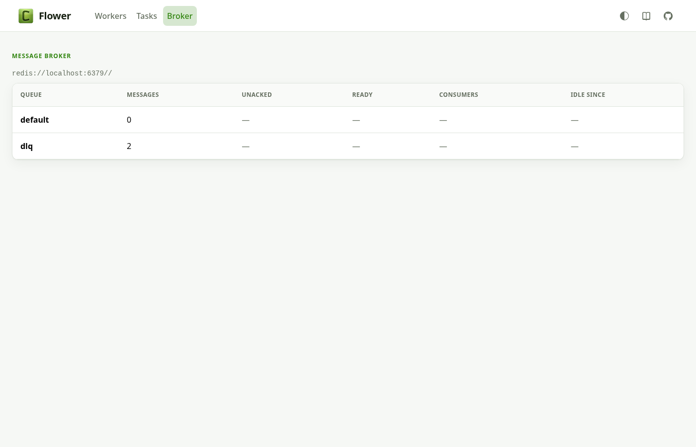

# Лабораторная работа 5. Фоновые задачи на Celery

## Задание

В «Сириус.Еде» `POST /orders/create` после сохранения заказа генерирует PDF-чек, отправляет email и SMS, и всё это синхронно - клиент ждёт около 4 секунд. Нужно:

- добавить заглушки PDF/email/SMS через `time.sleep` и замерить время ответа «до»;
- подключить Celery с Redis в роли брокера, вынести PDF, email и SMS в фоновые задачи;
- вызывать задачи из слоя Service (не из роутера);
- повторить замер и показать, что API отвечает мгновенно;
- на 8 баллов: ретраи с экспоненциальной задержкой, Dead Letter Queue, идемпотентность, README с графиками;
- на 9 баллов: мониторинг через Flower, скриншоты;
- на 10 баллов: периодическая задача через Celery Beat. Сделал обновление статистики: раз в минуту число заказов за день пишется в Redis.

Полный текст задания - в [task-lab5.md](task-lab5.md). README прошлых работ: [README-lab4.md](README-lab4.md), [README-lab3.md](README-lab3.md), lab2 - в коммите с тегом `lab2` (`git show lab2:README.md`).

## Что сделано

- `app/core/celery_app.py` - приложение Celery: брокер и backend результатов - Redis, JSON-сериализация, очереди `default` и `dlq`, базовый класс задач `TaskWithDLQ`, расписание Beat.
- `app/tasks/orders.py` - задачи `generate_order_pdf`, `send_order_email`, `send_order_sms` (заглушки на `time.sleep`).
- `OrderService.create_order` после сохранения заказа ставит задачи в очередь через `.delay()`. Роутер не менялся.
- Ретраи: email и SMS при ошибке повторяются до 3 раз с экспоненциальной задержкой. Email падает для каждого заказа с id, кратным 5 (как в методичке).
- Dead Letter Queue: задача, которая упала после всех ретраев, кладётся в очередь `dlq` и лежит там, пока её не разберут.
- Идемпотентность: каждая задача после выполнения ставит в Redis флаг (`pdf_generated:<id>`, `email_sent:<id>`, `sms_sent:<id>`) на час. Повторный запуск с тем же заказом ничего не делает.
- Celery Beat: задача `update_orders_stats` раз в минуту считает заказы за сегодня и пишет число в Redis `stats:orders:<дата>`. Для этого у заказа появилось время создания `created_at` (миграция).
- Flower: скриншоты в `screenshots/`.
- Замеры: `loadtest/lab5/before.txt`, `loadtest/lab5/after.txt`, график `loadtest/lab5/orders_time.png` (скрипт `loadtest/lab5/plot.py`).
- В тестах задачи Celery подменяются заглушками (`unittest.mock.patch`), чтобы тесты не складывали задачи в настоящую очередь.

## Как запустить

PostgreSQL и Redis:

```bash
docker compose up -d db redis
```

Зависимости (в `requirements.txt` добавлены `celery` и `flower`) и миграция с `orders.created_at`:

```bash
source .venv/bin/activate
pip install -r requirements.txt
alembic upgrade head
```

Дальше каждый процесс - в своём терминале (все из корня проекта, с активированным `.venv`).

API (Swagger на http://127.0.0.1:8000/docs при `DEBUG=True`):

```bash
uvicorn app.main:app --reload
```

Воркер Celery. `-Q default` обязательно: воркер должен слушать только обычную очередь, а не `dlq` (почему - в разделе про DLQ):

```bash
celery -A app.core.celery_app worker -Q default --loglevel=info
```

Celery Beat (расписание периодических задач):

```bash
celery -A app.core.celery_app beat --loglevel=info
```

Flower, открыть http://localhost:5555:

```bash
celery -A app.core.celery_app flower
```

Тесты (нужен Redis, PostgreSQL и воркер не нужны):

```bash
python -m unittest discover tests -v
```

Токен для запросов: войти студентом через `POST /auth/login` (в Swagger или curl) и взять `access_token`:

```bash
export TOKEN=<access_token>
curl -X POST "http://127.0.0.1:8000/orders/create" -H "Authorization: Bearer $TOKEN" -H "Content-Type: application/json" -d '{"item_id": 1, "quantity": 2}'
```

Для замеров завёл отдельного студента с телефоном (`POST /users/register`) и пополнил ему баланс (`POST /users/{id}/topup`), чтобы хватило на все тестовые заказы.

### Как делал замеры

Сервер для замеров запускал как в lab4: без `--reload` и с `DEBUG=False` (иначе в терминал печатается каждый SQL-запрос):

```bash
DEBUG=False uvicorn app.main:app --host 127.0.0.1 --port 8000
```

Один запрос - `time curl ...`, как в методичке. Для графика - 10 запросов подряд, curl печатает время каждого (`%{time_total}`, в секундах):

```bash
for i in $(seq 1 10); do curl -s -o /dev/null -w "%{time_total}\n" -X POST "http://127.0.0.1:8000/orders/create" -H "Authorization: Bearer $TOKEN" -H "Content-Type: application/json" -d '{"item_id": 1, "quantity": 2}'; done > loadtest/lab5/before.txt
```

«До» - на коммите `3e8e82a` (заглушки `time.sleep` прямо в сервисе), «после» - на коммите `5cd7cce` (задачи через Celery, воркер запущен), файл `after.txt`. График:

```bash
python loadtest/lab5/plot.py
```

## История коммитов

```text
65123ca ...                                                    (lab4, тег lab4)
3e8e82a Lab5 шаг 1: имитация тяжёлых операций (PDF, email, SMS) в OrderService, замер baseline
5cd7cce Lab5 шаги 2-6: Celery на Redis, задачи PDF/email/SMS, вызов через .delay() из OrderService, замер после
f13cfe0 Lab5 шаги 7-9: ретраи, идемпотентность, очереди default и dlq, TaskWithDLQ
2773d84 Lab5: Celery Beat - статистика заказов за день в Redis (orders.created_at, миграция), flower
...     Lab5: задание (task.md), README, график, скриншоты Flower
```

## Структура (что добавилось после lab4)

```text
app/
├── core/
│   └── celery_app.py         # новый: Celery, очереди default/dlq, TaskWithDLQ, beat_schedule
├── tasks/                    # новый: фоновые задачи
│   ├── __init__.py
│   ├── orders.py             # generate_order_pdf, send_order_email, send_order_sms
│   └── stats.py              # update_orders_stats (для Beat)
├── models.py                 # Order.created_at
├── memory_db.py              # OrderRecord.created_at
└── modules/orders/
    ├── service.py            # .delay() после сохранения заказа, count_orders_by_day
    ├── repository.py         # count_orders_by_day, created_at при сохранении
    └── router.py             # без изменений
alembic/versions/cd69256dbf7b_add_orders_created_at.py
loadtest/lab5/                # before.txt, after.txt, plot.py, orders_time.png
screenshots/                  # скриншоты Flower
tests/                        # задачи Celery подменяются заглушками
```

`service.py` не импортирует ни fastapi, ни sqlalchemy, ни celery - только функции задач:

```bash
$ grep -n "import" app/modules/orders/service.py
5:from app.exceptions import NotFoundError, AccessDeniedError
6:from app.modules.orders.repository import OrderRepository
7:from app.tasks.orders import generate_order_pdf, send_order_email, send_order_sms
```

## Как это работает

```text
клиент --POST /orders/create--> router --> OrderService.create_order
                                              | проверки, списание баланса,
                                              | save_order (COMMIT в PostgreSQL)
                                              | generate_order_pdf.delay(id)  --LPUSH-->  Redis, список "default"
                                              | send_order_email.delay(id, email)  -->        |
                                              | send_order_sms.delay(id, phone)    -->        |
клиент <--{"order_id": 42} (~15 мс)-----------+                                               |
                                                                                              v
                                                         воркер Celery (12 процессов) забирает сообщения,
                                                         три задачи выполняются параллельно (~2 с),
                                                         результат -> Redis celery-task-meta-<id>

Celery Beat --раз в 60 с--> update_orders_stats в "default" --> воркер --> SELECT count(*) --> Redis stats:orders:<дата>
```

Ключи в Redis, которые появились в lab5:

```text
default                  очередь задач (список), обычно пустая - воркер сразу забирает
dlq                      Dead Letter Queue (список), задачи, упавшие после всех ретраев
pdf_generated:<id>       флаги идемпотентности, TTL 3600 с
email_sent:<id>
sms_sent:<id>
stats:orders:<дата>      число заказов за день (пишет Beat-задача)
celery-task-meta-<uuid>  результаты задач (backend), Celery хранит их сутки
_kombu.binding.*         служебные ключи kombu: какая очередь к какому exchange привязана
```

### Ретраи

```text
send_order_email(35, ...)  -> Exception -> retry, задержка случайная 0..1 с
                           -> Exception -> retry, 0..2 с
                           -> Exception -> retry, 0..4 с
                           -> Exception -> ретраи кончились (max_retries=3) -> FAILURE
                                        -> TaskWithDLQ.on_failure -> копия задачи в очередь dlq
```

Задержка `2^номер_попытки` секунд (1, 2, 4, ... до `retry_backoff_max=600`). Из-за `retry_jitter=True` Celery берёт случайное число от 0 до этой задержки. Поэтому в логе не ровно 1, 2, 4 с, а например 1, 0, 4.

### DLQ

Сама Celery на Redis не умеет «перекладывать» упавшие задачи в другую очередь: в методичке объявлены очереди `default` и `dlq`, но без кода в `dlq` ничего не попадёт. Поэтому у задач базовый класс `TaskWithDLQ`: в `on_failure` (Celery вызывает его только когда задача упала окончательно, на ретраях - нет) он отправляет ту же задачу с теми же аргументами в очередь `dlq`.

Воркер запускается с `-Q default`. Без этого флага он слушал бы все очереди из `task_queues`, в том числе `dlq`, и сразу же снова выполнял бы упавшие задачи.

Посмотреть DLQ: `docker compose exec redis redis-cli -n 0 lrange dlq 0 -1` или вкладка Broker во Flower. В сообщении видно имя задачи (`headers.task`), аргументы (`argsrepr`) и id исходной задачи (`root_id`, по нему её можно найти во Flower вместе с ошибкой).

Разобрать DLQ:
- исправить причину и выполнить задачи из `dlq` заново - запустить воркер на эту очередь: `celery -A app.core.celery_app worker -Q dlq --loglevel=info`. Если причина не исправлена, задача после ретраев снова вернётся в `dlq` (и такой воркер будет гонять её по кругу, поэтому его запускают только на время разбора);
- или просто очистить: `celery -A app.core.celery_app purge -Q dlq`.

## Что сделал не так, как в методичке, и почему

1. `create_order` в проекте с lab2 принимает `user_id` и возвращает id заказа, а не объект `Order`. У заказа нет связи `customer`, поэтому email и телефон беру у `user`, которого сервис и так загружает в начале для проверки баланса: `send_order_email.delay(order_id, user.email)`.
2. SMS отправляется, только если у пользователя есть телефон: при регистрации он необязательный (`phone: str | None`). Иначе задача «отправляла» бы SMS на `None`.
3. В `Celery(...)` добавлен `include=["app.tasks.orders", "app.tasks.stats"]`. Воркер запускается с `-A app.core.celery_app` и импортирует только этот файл; без `include` он не знает о задачах из `app/tasks/` и на каждое сообщение пишет «Received unregistered task».
4. DLQ: в методичке только объявлены очереди, и задачи туда не попадают. Сделал `TaskWithDLQ.on_failure` и запуск воркера с `-Q default` (выше).
5. Ретраи сделал не только у email, но и у SMS: это тоже внешний сервис. У PDF ретраев нет - это наша внутренняя операция, но `TaskWithDLQ` есть у всех трёх задач: если генерация PDF упадёт, задача тоже не потеряется.
6. Идемпотентность не только у PDF (шаг 8), но и у email и SMS - в целях работы сказано про дубли «чеков или писем». Флаг ставится только после успешной отправки, поэтому упавший email ретраится, а уже отправленный повторно не уходит.
7. В методичке написано «задержка 1с, 2с, 4с», но в её же коде `retry_jitter=True`, а с ним задержка случайная (от 0 до 1, 2, 4 с). Оставил код методички, в логе это видно: `Retry in 1s`, `Retry in 0s`, `Retry in 4s`.
8. «Сообщения о превышении max_retries» в логе нет: при `autoretry_for` после последней попытки Celery пробрасывает исходное исключение, а не `MaxRetriesExceededError`. В логе - `raised unexpected: Exception('Email service unavailable')`, во Flower у задачи `Retries: 3` и статус `FAILURE`.
9. `pdf_generated:<id>` и остальные ключи лежат в Redis базы 0 - там же, где очередь и кеш из lab4 (у нас один `REDIS_URL`).
10. Для Beat выбрал статистику: таблицы `task_logs` в проекте нет. У заказов не было времени создания, добавил `created_at` миграцией. У заказов, созданных до миграции, оно `NULL` (когда они созданы, уже не узнать), в статистику они не попадают. Время ставит SQLAlchemy (`default=datetime.now`), то есть в часовом поясе приложения, и задача считает «сегодня» через `date.today()` в том же поясе. Если бы время ставил PostgreSQL (`now()`), в Docker он в UTC, и около полуночи день не совпадал бы.
11. Задача Beat - точка входа, как роутер: сама открывает сессию БД и вызывает `OrderService.count_orders_by_day`, а SQL-запрос - в репозитории. Число кладётся в Redis (задание это разрешает), отдельную таблицу не делал.
12. Замер - не один `time curl`, а 10 запросов подряд (для графика). Один `time curl` тоже есть в примере вывода.
13. Начисление бонусов из теории (п. 2.1) не делал: бонусов в проекте нет, и в шагах их нет.
14. Тесты: в `setUp` задачи Celery подменяются `unittest.mock.patch`, иначе каждый тест с заказом клал бы задачи в настоящую очередь Redis, и запущенный воркер их выполнял бы.

## Разбор кода

### app/core/celery_app.py

- `Celery("sirius_food", broker=..., backend=..., include=[...])` - приложение. Broker - куда кладутся задачи (Redis, списки). Backend - куда воркер пишет результат и статус задачи (`celery-task-meta-<id>`). `include` - модули с задачами для воркера.
- `conf.update(task_serializer="json", accept_content=["json"], ...)` - задачи и результаты в JSON. Pickle опасен: при чтении он может выполнить код, а сообщения лежат в Redis, куда может записать кто-то посторонний. Из-за JSON в задачу передаются простые значения (`order_id`, email), а не объекты ORM.
- `task_queues` и `task_default_*` - две очереди (`default` и `dlq`), по умолчанию всё идёт в `default`.
- `beat_schedule` - расписание: задача `app.tasks.stats.update_orders_stats` каждые 60 секунд.
- `TaskWithDLQ(Task)` - базовый класс задачи. `on_failure` вызывается, когда задача упала окончательно; он вызывает `self.apply_async(args=args, kwargs=kwargs, queue="dlq")` - ставит ту же задачу в очередь `dlq` - и пишет в лог.

### app/tasks/orders.py

- `@celery_app.task` превращает функцию в задачу: у неё появляются `.delay()` / `.apply_async()`, а имя задачи - `app.tasks.orders.<функция>`.
- `generate_order_pdf(self, order_id)` - `bind=True` из методички: первым аргументом приходит сама задача (`self`), через неё доступны `self.request.id`, `self.request.retries`, `self.retry()`. Здесь он не используется, оставил как в методичке.
- Идемпотентность во всех трёх задачах одинаковая: ключ `<что>:<order_id>`; если `redis_client.exists(key)` - вернуть «already ...» без работы; иначе работа (`time.sleep`) и `setex(key, 3600, "1")` - флаг на час.
- `send_order_email` и `send_order_sms` - параметры ретраев: `autoretry_for=(Exception,)` - повторять при любом исключении, `retry_backoff=True` - экспоненциальная задержка, `retry_backoff_max=600` - не больше 10 минут, `retry_jitter=True` - случайная задержка, `max_retries=3` - не больше 3 повторов (всего 4 попытки).
- `if order_id % 5 == 0: raise Exception(...)` - имитация недоступного почтового сервиса из методички. Исключение - до `setex`, то есть письмо «не ушло».

### app/tasks/stats.py

`update_orders_stats` - берёт `date.today()`, открывает `SessionLocal()`, собирает `OrderService(get_order_repository(db))`, вызывает `count_orders_by_day`, закрывает сессию в `finally` и пишет `SET stats:orders:<дата> <число>`. Каждую минуту число пересчитывается заново, поэтому ничего не накапливается и не сбивается, если Beat пропустил запуск.

### app/modules/orders/service.py

После `save_order` (заказ уже закоммичен в БД) три вызова `.delay()`. `.delay(args)` - короткая запись `.apply_async(args)`: задача сериализуется в JSON и кладётся в Redis, функция сразу возвращает `AsyncResult` (id задачи), не дожидаясь выполнения. Сервис его не использует - клиенту нужен только id заказа. Если вызвать `generate_order_pdf(order_id)` без `.delay`, она выполнится прямо здесь, синхронно, и снова будет 4 секунды.

Новый метод `count_orders_by_day(day)` просто спрашивает репозиторий - бизнес-правил в подсчёте нет, но так задача Beat работает через те же слои, что и роутеры.

### app/modules/orders/repository.py, models.py, memory_db.py, миграция

- `Order.created_at = Column(DateTime, default=datetime.now, nullable=True)` - SQLAlchemy подставляет текущее время при INSERT.
- Миграция `cd69256dbf7b` добавляет колонку `orders.created_at` (nullable). `alembic check` после неё: «No new upgrade operations detected».
- `PostgresOrderRepository.count_orders_by_day` - `SELECT count(*) ... WHERE date(created_at) = :day`.
- `InMemoryOrderRepository` тоже реализует метод (иначе абстрактный класс не даст создать объект), а при сохранении ставит `created_at=datetime.now()`.

### tests/

В `setUp` у `OrderServiceTest` и `SecurityTest` три задачи в модуле `service` подменяются `MagicMock` через `patch(...)`, `addCleanup` возвращает их обратно после теста. Тесты проверяют сервис и HTTP-слой, а не Celery.

### loadtest/lab5/plot.py

Читает `before.txt` и `after.txt` (секунды, по строке на запрос), рисует среднее (столбцы) и каждый запрос (линии, логарифмическая шкала - иначе 15 мс рядом с 4000 мс не видно).

## Что происходит при запуске

1. `uvicorn` импортирует `app.main` -> роутер заказов -> `service.py` -> `app.tasks.orders` -> `app.core.celery_app`. Создаётся объект Celery, но к Redis он ещё не подключается.
2. Воркер (`celery ... worker -Q default`) импортирует `celery_app` и модули из `include`, печатает список задач, подключается к Redis и ждёт сообщений в списке `default`. Запускает 12 процессов (`prefork`, по числу ядер).
3. Beat раз в минуту кладёт в `default` сообщение для `update_orders_stats`. Flower подключается к Redis и включает воркеру отправку событий (в логе воркера: `Events of group {task} enabled by remote`).
4. Клиент шлёт `POST /orders/create`. Роутер проверяет токен и роль (lab3), сервис проверяет блюдо и баланс, списывает деньги, сохраняет заказ (COMMIT).
5. Три `.delay()` кладут три сообщения в Redis. Первый вызов после старта ещё и подключается к брокеру (поэтому первый запрос ~240 мс), дальше это доли миллисекунды.
6. Клиент получает `{"status":"success","order_id":...}` примерно через 15 мс.
7. Воркер раздаёт три задачи по процессам, они идут параллельно: SMS и email - 1 с, PDF - 2 с. Каждая проверяет флаг в Redis, «работает», ставит флаг. Результат - в `celery-task-meta-<id>`.
8. Если id заказа кратен 5, email падает, ретраится 3 раза и попадает в `dlq`.

## Результаты замеров

Всё на одном ноутбуке, один процесс uvicorn, `DEBUG=False`, 10 последовательных запросов `{"item_id": 1, "quantity": 2}`.

| | До (синхронно) | После (Celery) |
|---|---|---|
| Среднее время ответа | 4020 мс | 14.7 мс |
| Минимум | 4011 мс | 12.7 мс |
| Максимум | 4036 мс | 17.0 мс |
| `time curl` (один запрос) | 4.026 с | 0.029 с |

Быстрее примерно в 270 раз. До Celery время ответа - это 4 секунды `sleep` плюс ~15 мс работы самого эндпоинта (токен, проверки, два COMMIT). После - только эти ~15 мс: `.delay()` - это одна команда `LPUSH` в Redis.



В методичке ожидается 50–100 мс, у нас меньше: БД и Redis на той же машине, нагрузки нет. Самый первый запрос после старта сервера был 243 мс - при первом `.delay()` открывается соединение с брокером.

Ещё одна разница, которой нет в таблице: в фоне три задачи заказа выполняются параллельно в разных процессах воркера, поэтому чек и уведомления готовы через ~2 с после заказа (самая долгая задача - PDF), а не через 4 с.

## Flower

Дашборд в момент, когда воркер выполняет задачи (только что создано 4 заказа, `Active tasks: 8`):



Список задач в тот же момент - задачи в состоянии `STARTED`, ниже выполненная задача Beat и упавший email:



Список задач после выполнения: `SUCCESS` у PDF/SMS/email, `FAILURE` у email заказа 35, задача Beat `update_orders_stats`:



Карточка упавшей задачи: аргументы `(35, 'celery@sirius.ru')`, `Retries: 3`, исключение `Email service unavailable`:



Вкладка Broker: очередь `default` пустая (воркер всё забрал), в `dlq` - 2 задачи (email заказов 30 и 35):



Время во Flower - в UTC (`timezone="UTC"` в настройках Celery), в логах воркера - местное (MSK, +3 часа).

## Пример вывода

### Тесты

```text
$ python -m unittest discover tests
.............................................
----------------------------------------------------------------------
Ran 45 tests in 6.060s

OK
```

### Шаг 1: замер до Celery

```text
$ time curl -X POST "http://127.0.0.1:8000/orders/create" -H "Authorization: Bearer $TOKEN" -H "Content-Type: application/json" -d '{"item_id": 1, "quantity": 2}'
{"status":"success","order_id":8}
... 0,01s user 0,00s system 0% cpu 4,026 total
```

### Шаг 5: запуск воркера

```text
$ celery -A app.core.celery_app worker -Q default --loglevel=info
 -------------- celery@hunter v5.6.3 (recovery)
- ** ---------- .> app:         sirius_food:0x7f0fc7954830
- ** ---------- .> transport:   redis://localhost:6379//
- ** ---------- .> results:     redis://localhost:6379/
- *** --- * --- .> concurrency: 12 (prefork)
-- ******* ---- .> task events: OFF (enable -E to monitor tasks in this worker)
 -------------- [queues]
                .> default          exchange=default(direct) key=default

[tasks]
  . app.tasks.orders.generate_order_pdf
  . app.tasks.orders.send_order_email
  . app.tasks.orders.send_order_sms
  . app.tasks.stats.update_orders_stats

[2026-10-19 16:04:24,398: INFO/MainProcess] Connected to redis://localhost:6379//
[2026-10-19 16:04:25,405: INFO/MainProcess] mingle: all alone
```

### Шаг 6: замер после и лог воркера

```text
$ time curl -s -X POST "http://127.0.0.1:8000/orders/create" -H "Authorization: Bearer $TOKEN" -H "Content-Type: application/json" -d '{"item_id": 1, "quantity": 2}'
{"status":"success","order_id":42}
... 0,00s user 0,01s system 31% cpu 0,029 total
```

Лог воркера на заказ (заказ 19, шаг 6):

```text
[15:56:45,435: INFO/MainProcess] Task app.tasks.orders.generate_order_pdf[9acc7975-...] received
[15:56:45,437: INFO/MainProcess] Task app.tasks.orders.send_order_email[a8dd724b-...] received
[15:56:45,438: INFO/MainProcess] Task app.tasks.orders.send_order_sms[104ce72c-...] received
[15:56:46,443: INFO/ForkPoolWorker-8] Task app.tasks.orders.send_order_email[a8dd724b-...] succeeded in 1.005s: 'Email sent to celery@sirius.ru for order 19'
[15:56:46,443: INFO/ForkPoolWorker-1] Task app.tasks.orders.send_order_sms[104ce72c-...] succeeded in 1.004s: 'SMS sent to +79001234567 for order 19'
[15:56:47,441: INFO/ForkPoolWorker-7] Task app.tasks.orders.generate_order_pdf[9acc7975-...] succeeded in 2.005s: 'PDF generated for order 19'
```

Три разных процесса (`ForkPoolWorker-8`, `-1`, `-7`), всё готово через 2 секунды.

### Шаги 7 и 9: ретраи и DLQ (заказ 35)

```text
[16:02:38,056: INFO/MainProcess] Task app.tasks.orders.send_order_email[a08a67c3-...] received
[16:02:39,065: INFO/ForkPoolWorker-4] Task app.tasks.orders.send_order_sms[ab417d7e-...] succeeded in 1.005s: 'SMS sent to +79001234567 for order 35'
[16:02:39,082: INFO/ForkPoolWorker-11] Task app.tasks.orders.send_order_email[a08a67c3-...] retry: Retry in 1s: Exception('Email service unavailable')
[16:02:40,063: INFO/ForkPoolWorker-3] Task app.tasks.orders.generate_order_pdf[dc7054a0-...] succeeded in 2.005s: 'PDF generated for order 35'
[16:02:41,077: INFO/ForkPoolWorker-7] Task app.tasks.orders.send_order_email[a08a67c3-...] retry: Retry in 0s: Exception('Email service unavailable')
[16:02:42,088: INFO/ForkPoolWorker-8] Task app.tasks.orders.send_order_email[a08a67c3-...] retry: Retry in 4s: Exception('Email service unavailable')
[16:02:47,084: ERROR/ForkPoolWorker-7] Задача app.tasks.orders.send_order_email[a08a67c3-...] отправлена в DLQ: Exception('Email service unavailable')
[16:02:47,084: ERROR/ForkPoolWorker-7] Task app.tasks.orders.send_order_email[a08a67c3-...] raised unexpected: Exception('Email service unavailable')
Traceback (most recent call last):
  ...
  File ".../app/tasks/orders.py", line 53, in send_order_email
    raise Exception("Email service unavailable")
Exception: Email service unavailable
```

Id задачи на всех попытках один и тот же: ретрай - это та же задача, поставленная в очередь заново с задержкой. PDF и SMS заказа 35 выполнились нормально - падение email на них не влияет. Для заказа 30 задержки были 1 с, 2 с, 0 с.

Содержимое DLQ (сообщение для заказа 30, сокращено):

```text
$ docker compose exec redis redis-cli -n 0 lrange dlq 0 -1
{"body": "W1szMCwgImNlbGVyeUBzaXJpdXMucnUiXSwge30s...", "content-type": "application/json",
 "headers": {"lang": "py", "task": "app.tasks.orders.send_order_email", "id": "24eb3e5d-...", "retries": 0,
 "root_id": "51cc12b6-...", "parent_id": "51cc12b6-...", "argsrepr": "[30, 'celery@sirius.ru']", ...},
 "properties": {..., "delivery_info": {"exchange": "", "routing_key": "dlq"}, ...}}
```

### Шаг 8: идемпотентность

Задачи вызвал вручную ещё раз для уже обработанного заказа 30, и дважды для нового «заказа» 1000:

```text
$ python -c "
from app.tasks.orders import generate_order_pdf, send_order_sms
print(generate_order_pdf.delay(30).get(timeout=10))
print(send_order_sms.delay(30, '+79001234567').get(timeout=10))
print(generate_order_pdf.delay(1000).get(timeout=10))
print(generate_order_pdf.delay(1000).get(timeout=10))
"
PDF already generated for order 30
SMS already sent for order 30
PDF generated for order 1000
PDF already generated for order 1000
```

Лог воркера: повторы выполнились за ~1 мс вместо 2 с - работы не было:

```text
[15:59:33,361: INFO/ForkPoolWorker-7] Task app.tasks.orders.generate_order_pdf[e5f0c90a-...] succeeded in 0.0011s: 'PDF already generated for order 30'
[15:59:33,364: INFO/ForkPoolWorker-7] Task app.tasks.orders.send_order_sms[7e43e3fe-...] succeeded in 0.0008s: 'SMS already sent for order 30'
[15:59:35,368: INFO/ForkPoolWorker-7] Task app.tasks.orders.generate_order_pdf[7fdea046-...] succeeded in 2.0017s: 'PDF generated for order 1000'
[15:59:35,372: INFO/ForkPoolWorker-7] Task app.tasks.orders.generate_order_pdf[dc49d2cc-...] succeeded in 0.0008s: 'PDF already generated for order 1000'
```

### Celery Beat

Лог Beat:

```text
[2026-10-19 16:01:20,392: INFO/MainProcess] beat: Starting...
[2026-10-19 16:02:20,413: INFO/MainProcess] Scheduler: Sending due task update-orders-stats-every-minute (app.tasks.stats.update_orders_stats)
[2026-10-19 16:03:20,410: INFO/MainProcess] Scheduler: Sending due task update-orders-stats-every-minute (app.tasks.stats.update_orders_stats)
[2026-10-19 16:04:20,410: INFO/MainProcess] Scheduler: Sending due task update-orders-stats-every-minute (app.tasks.stats.update_orders_stats)
```

Лог воркера и Redis (до 16:02 после миграции было создано 2 заказа, к 16:04 - 10):

```text
[16:02:20,466: INFO/ForkPoolWorker-7] Task app.tasks.stats.update_orders_stats[685bff94-...] succeeded in 0.042s: 'Orders for 2026-10-19: 2'
[16:04:25,470: INFO/ForkPoolWorker-9] Task app.tasks.stats.update_orders_stats[10971653-...] succeeded in 0.043s: 'Orders for 2026-10-19: 10'

$ docker compose exec redis redis-cli get stats:orders:2026-10-19
"12"
```

С `DEBUG=True` в `.env` в логе воркера виден и сам SQL-запрос задачи (`SELECT count(*) ... WHERE date(orders.created_at) = ...`).

### Воркер выключен

Остановил воркер и создал заказ 40:

```text
$ time curl -s -X POST ".../orders/create" ...
{"status":"success","order_id":40}  ... 0,033 total
$ docker compose exec redis redis-cli llen default
3
```

API работает как обычно, три задачи лежат в очереди. После запуска воркера они сразу выполнились (вместе с задачей Beat, которая встала в очередь, пока воркера не было):

```text
[16:04:25,422: INFO/MainProcess] Task app.tasks.orders.generate_order_pdf[ca122f38-...] received
[16:04:25,423: INFO/MainProcess] Task app.tasks.orders.send_order_email[046bd140-...] received
[16:04:25,425: INFO/MainProcess] Task app.tasks.orders.send_order_sms[a9f7631b-...] received
[16:04:25,426: INFO/MainProcess] Task app.tasks.stats.update_orders_stats[10971653-...] received
[16:04:26,433: INFO/ForkPoolWorker-1] Task app.tasks.orders.send_order_sms[a9f7631b-...] succeeded in 1.006s: 'SMS sent to +79001234567 for order 40'
[16:04:27,430: INFO/ForkPoolWorker-7] Task app.tasks.orders.generate_order_pdf[ca122f38-...] succeeded in 2.006s: 'PDF generated for order 40'
```

(email заказа 40 - кратного 5 - ушёл в ретраи и в DLQ.)

### Redis выключен (`docker compose stop redis`)

```text
$ curl -s -X POST ".../orders/create" ...
Internal Server Error
```

В логе uvicorn `kombu.exceptions.OperationalError: Error 111 connecting to localhost:6379. Connection refused.` А в БД заказ 41 есть, деньги списаны: `.delay()` вызывается после COMMIT. Клиент получил ошибку, хотя заказ создан, а чек и уведомления потеряны. Это недостаток схемы «сначала БД, потом брокер», в задании его исправлять не требуется; как исправить - в вопросах ниже. После `docker compose start redis` воркер сам переподключился, следующий заказ 42 прошёл нормально.

## Известная проблема

После перезапуска Redis в логе Beat (и uvicorn) может появиться:

```text
Exception ignored in: <function AsyncResult.__del__ ...>
...
TypeError: ConnectionPool.get_connection() missing 1 required positional argument: 'command_name'
```

Это несовместимость Celery 5.6 с redis-py 5.0.3 (версия зафиксирована в `requirements.txt` с lab3): при переподключении Celery вызывает `get_connection()` без аргумента, а в redis-py до 5.3.0 он обязательный. Ошибка «ignored» - в сборщике мусора, Beat продолжает работать (следующая задача отправлена в 16:06:20 как обычно). Исправляется обновлением redis-py до 5.3.0 или новее, но версию из прошлых лаб в этой работе не менял.

## Ответы на контрольные вопросы

**1. Почему вызов фоновых задач в Service, а не в Router? Как это связано с Clean Architecture?**
«После заказа сгенерировать чек и отправить уведомления» - это часть сценария оформления заказа, то есть бизнес-правило. Его место - в сервисе, рядом с «проверить баланс» и «списать деньги». Роутер - транспортный слой: принять HTTP, проверить токен, вызвать сервис, перевести ошибки в статусы. Если поставить `.delay()` в роутер, то заказ, созданный другим путём (другой эндпоинт, админка, скрипт, другая очередь), останется без чека и писем - правило размазано по точкам входа. Repository про Celery тоже не знает: он только хранит данные. Сервис при этом не знает ни про Redis, ни про kombu: он вызывает функции из `app.tasks.orders`, а как они попадут в очередь - решает Celery. В unit-тестах эти функции подменяются заглушками, и сервис тестируется без брокера. (Строго говоря, ещё чище было бы передавать в сервис интерфейс «уведомитель», как репозиторий, но методичка допускает прямой вызов задач из сервиса.)

**2. Что произойдёт, если Celery-воркер отключится во время выполнения задачи?**
- Задачи, которые ещё в очереди, не пропадут: они лежат в Redis и будут выполнены, когда воркер вернётся (проверено выше: 3 задачи дождались воркера). API при этом продолжает работать.
- Обычная остановка (Ctrl+C один раз, warm shutdown) - воркер перестаёт брать новые задачи и доделывает текущие.
- Если процесс убит посреди задачи (`kill -9`, выключили сервер), по умолчанию эта задача потеряна: Celery подтверждает (ack) сообщение брокеру в момент, когда берёт задачу, а не когда закончил. Чтобы не терять, ставят `acks_late=True` и `task_reject_on_worker_lost=True`: подтверждение после выполнения, а неподтверждённое сообщение Redis-транспорт вернёт в очередь (по истечении `visibility_timeout`, по умолчанию час). Тогда задача может выполниться повторно - и тут нужна идемпотентность.
- Задачи, отложенные на ретрай (с `countdown`), воркер держит у себя неподтверждёнными, поэтому при падении воркера они вернутся в очередь после `visibility_timeout`.

**3. Что такое идемпотентность и почему она важна для фоновых задач?**
Идемпотентная операция при повторном выполнении даёт тот же результат, что и при однократном: второй запуск не отправит второе письмо и не создаст второй чек. Celery гарантирует «хотя бы один раз», а не «ровно один»: задача может выполниться повторно из-за ретрая, повторной доставки после падения воркера (`acks_late`), ручного перезапуска из DLQ. Повторный email или SMS клиенту - это заметная ошибка, повторный платёж - потеря денег. У нас перед работой проверяется флаг в Redis, после работы он ставится. Ограничения такого способа: проверка и установка не атомарны (две копии задачи, запущенные одновременно, обе увидят «флага нет»), и если процесс упадёт между отправкой и `setex`, повтор всё-таки отправит письмо. Надёжнее - атомарный `SET key NX` перед работой или ключ идемпотентности, который принимает сам внешний сервис (так умеют многие API рассылок и платежей).

**4. Зачем нужны ретраи с экспоненциальной задержкой?**
Ошибки внешних сервисов часто временные: сеть, перезапуск, перегрузка. Повтор через время - и письмо уйдёт. Если повторять сразу, все попытки сгорят за секунду, пока сервис ещё лежит, и каждая попытка его дополнительно нагружает. Экспоненциальная задержка (1, 2, 4, 8 ... с) даёт сервису время подняться, а при долгом сбое запросов становится всё меньше. `retry_backoff_max` ограничивает задержку сверху. Jitter (случайная часть) нужен, когда падают сразу тысячи задач: без него они все повторятся в одну и ту же секунду и снова «положат» сервис (как cache stampede в lab4). `max_retries` - чтобы не повторять бесконечно.

**5. Что такое Dead Letter Queue и как её использовать?**
Отдельная очередь для сообщений, которые не удалось обработать после всех попыток. Зачем: задача не теряется (видно, что именно не отправилось и с какими аргументами), не блокирует основную очередь и не крутится в ретраях вечно. Как используем: смотрим `redis-cli lrange dlq 0 -1` или Broker во Flower, по `root_id` находим во Flower ошибку, исправляем причину и выполняем задачи заново воркером на очередь `dlq` (`celery -A app.core.celery_app worker -Q dlq`) или очищаем очередь (`celery -A app.core.celery_app purge -Q dlq`). В продакшене на размер DLQ ставят алерт: если она растёт, что-то сломалось.

**6. Почему Celery - стандарт индустрии, а не просто threading или asyncio?**
Поток или `asyncio`-задача (и `BackgroundTasks` FastAPI) живут внутри процесса веб-сервера:
- перезапуск или падение uvicorn - незаконченные задачи пропали, очереди нет нигде, кроме памяти;
- тяжёлая работа отнимает CPU у API (GIL), а синхронный код в `asyncio` блокирует весь event loop;
- нельзя вынести задачи на другие серверы и масштабировать их отдельно от API;
- ретраи, отложенный запуск, расписание, хранение результатов, мониторинг - всё писать самому.
У Celery очередь хранится в брокере (переживает перезапуск API), воркеры - отдельные процессы, их можно запустить сколько угодно и на других машинах, есть ретраи с backoff, `countdown`/ETA, Beat, маршрутизация по очередям, Flower. Для лёгкого «записать в лог после ответа» `BackgroundTasks` хватает, для PDF и рассылок - нет.

**7. Чем Celery Beat отличается от обычной задачи?**
Обычную задачу ставит в очередь код в ответ на событие: создан заказ -> `.delay()`. Beat - отдельный процесс-планировщик: по расписанию (`beat_schedule`: интервал или crontab) он сам кладёт задачу в очередь. Выполняет её всё равно обычный воркер, Beat только «нажимает кнопку». Сама `update_orders_stats` - обычная задача, её можно вызвать и вручную через `.delay()`. Beat должен быть запущен в одном экземпляре: два Beat поставят каждую задачу дважды. Своё состояние (когда что запускал) он хранит в файле `celerybeat-schedule` (добавлен в `.gitignore`).

## Другие вопросы, которые могут задать

**Что делает `.delay()` и чем отличается от вызова функции?**
`generate_order_pdf(30)` выполнит функцию здесь и сейчас, в процессе FastAPI. `generate_order_pdf.delay(30)` сериализует имя задачи и аргументы в JSON, кладёт сообщение в Redis и сразу возвращает `AsyncResult` с id задачи. `.delay(*args)` - короткая форма `.apply_async(args=...)`; у `apply_async` есть ещё параметры: `countdown`, `queue` и т.д.

**Почему в задачу передаётся `order_id` и email, а не объект заказа?**
Аргументы уходят в JSON - ORM-объект туда не сериализуется. К тому же объект к моменту выполнения мог бы устареть, а сообщение в очереди должно быть маленьким.

**Где хранятся результаты задач и зачем backend?**
В Redis, ключи `celery-task-meta-<id>`, сутки. По ним `AsyncResult.get()` получает результат (так проверялась идемпотентность), а Flower показывает статус. Сам сервис результаты не ждёт.

**Почему ответ 15 мс, а не 50-100 мс, как в методичке?**
Всё локально и без нагрузки. Из 15 мс почти всё - сам эндпоинт: проверка токена, загрузка пользователя и блюда, два COMMIT в PostgreSQL. `.delay()` - одна команда в Redis, доли миллисекунды.

**Почему задачи заказа выполняются параллельно?**
Воркер по умолчанию запускает пул процессов по числу ядер (`concurrency: 12 (prefork)`), три задачи попадают в разные процессы. Это видно по `ForkPoolWorker-8`, `-1`, `-7` в логе.

**Что будет, если упадёт Redis?**
Проверено выше: `.delay()` бросает `OperationalError`, клиент получает 500, хотя заказ уже сохранён и деньги списаны, а чек и письма не будут отправлены. (Вход тоже не работает - на Redis rate limiting из lab3.) Исправить можно паттерном transactional outbox: в той же транзакции, что и заказ, пишется строка в таблицу «нужно отправить», а отдельный процесс перекладывает такие строки в брокер, когда он доступен. Попроще - ловить ошибку брокера и возвращать успех, но тогда уведомления теряются молча.

**Почему воркер запускается с `-Q default`?**
Без `-Q` он слушает все очереди из `task_queues`, в том числе `dlq`, и сразу же снова выполнял бы упавшие задачи - DLQ потеряла бы смысл.

**Как Flower видит задачи, если у воркера `task events: OFF`?**
Flower при подключении сам отправляет воркерам команду включить события (`Events of group {task} enabled by remote` в логе воркера). Можно и сразу запускать воркер с `-E`.

**Можно ли оставить Flower открытым в продакшене?**
Нет: без настроек у него нет пароля, а через него видны аргументы задач (email, телефоны) и можно управлять воркерами. Нужна авторизация (`--basic-auth=user:password` или OAuth) и закрытый порт.

**Почему статистика в Redis, а не в таблице?**
Задание разрешает Redis. Это одно число на день, оно пересчитывается каждую минуту целиком, поэтому потерять его не страшно - через минуту будет снова. Для отчётов за длинный период лучше была бы таблица.

**Что значит `timezone="UTC"`?**
Время в Celery (ETA, Beat-расписания crontab, время во Flower) считается в UTC. На наш интервал «каждые 60 секунд» это не влияет. Поэтому во Flower время на 3 часа меньше, чем в логах воркера.
